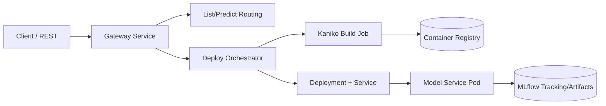

# Bentloy Model Serving

Production-oriented API gateway and model-serving stack on Kubernetes, using MLflow + BentoML.

## Overview

This project serves MLflow models through:

1. A `gateway` API that receives `/predict` and deployment requests.
2. One model service per model (`bentloy-model-<slug>`), deployed as independent Kubernetes workloads.
3. An asynchronous image-build pipeline (Kaniko Job) for image-per-model deployments.

## Architecture



## Quick Start

Requirements: Python 3.12, `docker` and `kubectl` pointing to the target cluster.

### 1) Configure

Copy `.env_example` to `.env` and fill in the required block:
`MLFLOW_TRACKING_URI`, `REGISTRY_SERVER`, `REGISTRY_USERNAME`,
`REGISTRY_PASSWORD` and `K8S_NAMESPACE` (default: `default`).
`REGISTRY_NAMESPACE` is optional (project/org inside the registry); images are
`<REGISTRY_SERVER>[/<REGISTRY_NAMESPACE>]/<image>`.

Docker Desktop (or the Docker engine) must be running to build the images.

### 2) Deploy the gateway

```bash
python bentloy.py up
```

One idempotent command that:

1. Builds and pushes the `gateway` and `model_service` base images, only if they
   are not in the registry yet (tags are a hash of their sources, so unchanged
   code is never rebuilt).
2. Creates the namespace and the registry pull secret.
3. Renders `k8s/templates/gateway.yaml` from `.env`, applies it and waits for the rollout.

Run it again after any code or `.env` change. `python bentloy.py up --dry-run`
shows the plan and the rendered manifests without touching anything.

### 3) Deploy a model

```bash
python bentloy.py deploy tiny_demo_model                 # latest version
python bentloy.py deploy tiny_demo_model --version 3 --name tiny_demo_prod
```

The gateway builds a dedicated image for the model (Kaniko Job in the cluster) and
deploys it; the command waits and prints the progress. Other commands:

```bash
python bentloy.py models                         # list models
python bentloy.py predict tiny_demo_prod x1=5 x2=2 x3=3   # prediction
python bentloy.py status <operation_id>          # deploy status
python bentloy.py delete tiny_demo_prod          # delete Deployment, Service and image
```

`predict` accepts `column=value` pairs, a JSON object of columns
(`'{"x1": 5, "x2": 2}'`), a JSON list of features in the model's column order
(`'[5, 2, 3]'`) or `--file input.json`.

These commands reach the gateway through `kubectl port-forward` automatically, or
through `GATEWAY_URL` if you set it in `.env`.

### Local development

```bash
py -3.12 -m venv .venv            # Linux/macOS: python3.12 -m venv .venv
.venv\Scripts\python -m pip install -r requirements.txt
python -m unittest discover -s gateway/tests -t .
python -m unittest discover -s model_service/tests -t .
python -m unittest discover -s tests -t .
```

## Common API calls

`<gateway_url>` can be LoadBalancer URL or `http://localhost:8000` via port-forward.

### List models

```bash
curl -X POST "<gateway_url>/list_models" \
  -H "Content-Type: application/json" \
  -d "{}"
```

### Predict

```bash
curl -X POST "<gateway_url>/predict" \
  -H "Content-Type: application/json" \
  -d '{
    "model_name": "tiny_demo_model",
    "data": { "features": [1.0, 2.0, 3.0] }
  }'
```

### Start async deploy by endpoint

```bash
curl -X POST "<gateway_url>/deploy_model" \
  -H "Content-Type: application/json" \
  -d '{
    "model_name": "tiny_demo_model_2",
    "model_version": "latest",
    "replicas": 1,
    "deployed_name": "tiny_demo_model_2_prod",
    "append_date": true
  }'
```

Use `deployed_name` as the `model_name` value in `/predict` when custom naming is enabled.

## Repository map

| Path | Purpose |
|---|---|
| `bentloy.py` | CLI: build images, deploy the gateway, deploy/list/delete models |
| `gateway/` | API gateway service and deploy orchestration |
| `model_service/` | BentoML model runtime (base image for per-model images) |
| `k8s/templates/` | Gateway and registry-secret manifests rendered by `bentloy.py` (see `k8s/README.md`) |
| `tests/` | Tests for `bentloy.py` |
| `docs/` | Runbook and gateway technical docs |

## Documentation

1. Runbook (operations, troubleshooting): `docs/runbook.md`
2. Gateway technical details: `docs/gateway_technical.md`
3. Kubernetes templates and future Helm mapping: `k8s/README.md`
