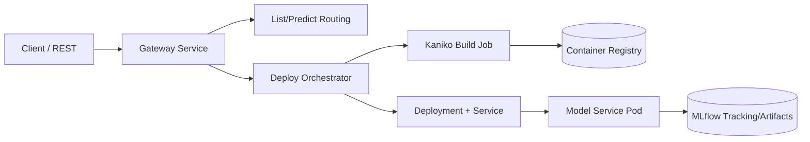

# NITRATE Model Serving

Production-oriented API gateway and model-serving stack on Kubernetes, using MLflow + BentoML.

## Overview

This project serves MLflow models through:

1. A `gateway` API that receives `/predict` and deployment requests.
2. One model service per model (`model-<slug>`), deployed as independent Kubernetes workloads.
3. An asynchronous image-build pipeline (Kaniko Job) for image-per-model deployments.

## Architecture



## Quick Start

### 1) Configure environment

Copy `.env_example` to `.env` and set at least:

1. `MLFLOW_TRACKING_URI`
2. `REGISTRY_SERVER`
3. `TU_ORG`
4. `REGISTRY_USERNAME` / `REGISTRY_PASSWORD`
5. `K8S_NAMESPACE` (default: `api-models`)

### 2) Build and push shared images (`gateway`, `model_service`)

PowerShell:

```powershell
.\k8s\build_images.ps1 -Tag 20260416-01 -RegistryPrefix <REGISTRY_SERVER>/<TU_ORG>
```

Bash:

```bash
./k8s/build_images.sh 20260416-01 <REGISTRY_SERVER>/<TU_ORG>
```

### 3) Deploy gateway

PowerShell:

```powershell
.\k8s\deploy_gateway.ps1 -Namespace api-models
kubectl -n api-models rollout status deploy/gateway --timeout=180s
```

Bash:

```bash
./k8s/deploy_gateway.sh api-models
kubectl -n api-models rollout status deploy/gateway --timeout=180s
```

### 4) Deploy one model image (image-per-model flow)

PowerShell:

```powershell
.\k8s\build_model_image_job.ps1 -ModelName tiny_demo_model -ModelVersion latest -Namespace api-models -Wait -InsecureRegistryTls
.\k8s\deploy_model_image.ps1 -ModelName tiny_demo_model -ModelImage <REGISTRY_SERVER>/<TU_ORG>/model-tiny-demo-model:<tag> -Namespace api-models -Replicas 1
```

## Common API calls

`<gateway_url>` can be LoadBalancer URL or `http://localhost:8000` via port-forward.

### List models

```bash
curl -X POST "<gateway_url>/list_models" \
  -H "Content-Type: application/json" \
  -d "{}"
```

### Predict

```bash
curl -X POST "<gateway_url>/predict" \
  -H "Content-Type: application/json" \
  -d '{
    "model_name": "tiny_demo_model",
    "data": { "features": [1.0, 2.0, 3.0] }
  }'
```

### Start async deploy by endpoint

```bash
curl -X POST "<gateway_url>/deploy_model" \
  -H "Content-Type: application/json" \
  -d '{
    "model_name": "tiny_demo_model_2",
    "model_version": "latest",
    "namespace": "api-models",
    "replicas": 1,
    "deployed_name": "tiny_demo_model_2_prod",
    "append_date": true
  }'
```

Use `deployed_name` as the `model_name` value in `/predict` when custom naming is enabled.

## Repository map

| Path | Purpose |
|---|---|
| `gateway/` | API gateway service and deploy orchestration |
| `model_service/` | Generic BentoML model runtime |
| `k8s/` | Build/deploy scripts (`.sh`, `.ps1`) |
| `k8s/bootstrap/` | One-time bootstrap scripts (secret + base image) |
| `k8s/yaml/` | Optional static gateway manifest |
| `examples/rest/` | Example request payloads |
| `docs/` | Runbook, technical docs, phases/history |

## Build behavior notes

`k8s/build_images.*` is now Dockerfile-only for shared images (`gateway`, `model_service`).

If `gateway/` and `model_service/` code/dependencies did not change, you can reuse existing published tags and skip rebuilding.

## Documentation

1. Main runbook: `docs/runbook.md`
2. Gateway technical details: `docs/gateway_technical.md`
3. Phase docs: `docs/phases/`
4. Historical notes: `docs/history/`
